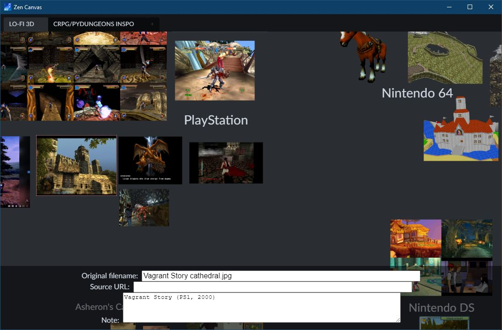

# Zen Canvas

## Development

1. create a virtual envioronment and install packages from requirements.txt
2. execute `manage.py runserver`
3. navigate to http://127.0.0.1:5000

Q: how to set DB path?

## Controls

(based on PureRef controls)

- LMB to select & drag objects
- MMB or arrows to pan
- Mouse wheel or +/- to zoom
- PageUp/Down to resize selected object (temporary)
- Delete to delete selected object
- Escape to cancel selection

Mobile controls (TODO)

- touch/pinch to pan & zoom
- long press to manipulate object
